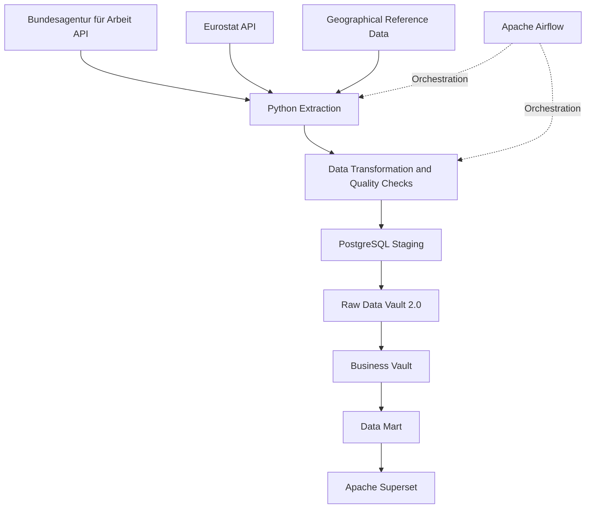

# German Labour Market Data Warehouse

An end-to-end Data Engineering project designed to integrate, transform, historize and analyse German labour market data using a Data Vault 2.0 architecture.

## 1. Project Overview

This project implements a data warehouse platform combining labour market statistics from two public data providers:

- **Bundesagentur für Arbeit (BA):** registered unemployment and underemployment indicators at German district level (Kreise).
- **Eurostat:** harmonised regional labour market indicators.

The objective is to build a reliable and traceable analytical data platform that supports historical analysis, geographical comparisons and business intelligence.

## 2. Technical Architecture



## 3. Technology Stack

| Area | Technology |
|---|---|
| Programming | Python |
| Data processing | Pandas, GeoPandas |
| Database | PostgreSQL 16 |
| Data architecture | Data Vault 2.0 |
| Orchestration | Apache Airflow |
| Business Intelligence | Apache Superset |
| Infrastructure | Docker, Docker Compose |
| Data integration | REST APIs, CSV, JSON |
| Query language | SQL |

## 4. Data Sources

### Bundesagentur für Arbeit

Labour market data covering German administrative districts (Kreise), including:

- Registered unemployed persons (Arbeitslose)
- Underemployment (Unterbeschäftigung)
- Monthly observations
- AGS geographical identifiers

### Eurostat

Regional labour market statistics used to complement national administrative data with harmonised European indicators.

### Geographical reference data

Geographical integration uses German administrative identifiers and European statistical classifications:

- AGS
- NUTS
- LAU

The geographical mapping supports the integration of BA district-level data and Eurostat regional data.

## 5. Data Warehouse Architecture

### 5.1 Staging Layer

The staging layer receives and prepares source data before loading it into the Raw Vault.

Responsibilities:

- Source-specific data preparation
- Structural standardisation
- Geographical mapping
- Validation of source records

### 5.2 Raw Data Vault 2.0

The Raw Vault provides an historised and auditable representation of the source data.

Main components:

- Hubs: business keys and identity management
- Links: relationships between business entities
- Satellites: descriptive attributes and historical changes
- Hash keys and hashdiffs: technical identification and change detection
- Load timestamps and record tracking

### 5.3 Business Vault

The Business Vault implements business rules independently of the original source structures.

It includes:

- Geographical harmonisation
- BA and Eurostat indicator distinction
- Comparable analytical periods
- Business views for downstream consumption

Registered unemployment from BA and harmonised unemployment indicators from Eurostat are treated as distinct measures. They must not be interpreted as identical indicators.

### 5.4 Data Mart

The Data Mart provides a dimensional analytical model for reporting.

Main structures:

- `dim_geography`
- `dim_indicator`
- `dim_period`
- `dim_source`
- `fact_labour_market`

Consumption views are provided for Apache Superset.

## 6. Project Structure

```text
labour-market-dwh/
├── dags/
│   └── labour_market_pipeline.py
├── data/
│   ├── processed/       # Quality reports and selected metadata
│   └── reference/       # Selected reference datasets
├── src/
│   ├── extract/         # BA and Eurostat ingestion
│   ├── transform/       # Data and geographical transformations
│   ├── validation/      # Data quality checks
│   └── postgres/
│       ├── staging/
│       ├── data_vault/
│       └── data_mart/
├── tests/
│   ├── explain/
│   └── SQL and Python validation scripts
├── docker-compose.yml
├── requirements.txt
├── .env.example
└── README.md
```

## 7. Data Quality and Validation

Data quality is an essential part of the platform.

Implemented checks include:

- Duplicate detection
- Missing value checks
- Numeric value validation
- Geographical mapping validation
- Referential consistency
- Historical version management

### Validation evidence

The following integration tests were successfully executed:

| Test | Description | Result |
|---|---|---|
| T2 | Idempotence of satellite loading | PASS |
| T3 | Synthetic September 2026 transaction and Data Mart consistency | PASS |
| T4 | Satellite historisation and version closure | PASS |

The T3 test verified the expected loading behaviour for 401 BA satellite rows and 802 Data Mart facts across two indicators. The test transaction was rolled back, leaving the August 2026 production state unchanged.

Additional SQL execution-plan and signature evidence is maintained in the test files.

## 8. Local Setup

### Prerequisites

- Git
- Python
- Docker Desktop
- PostgreSQL client (optional)

### Clone the repository

```bash
git clone https://github.com/worldappli/labour-market-dwh.git
cd labour-market-dwh
```

### Configure environment variables

Create a local `.env` file based on the example:

```bash
cp .env.example .env
```

Set your own database credentials in `.env`.

### Start PostgreSQL

```bash
docker compose up -d postgres
```

The database is exposed on local port `5433` and uses PostgreSQL 16.

### Install Python dependencies

Use a virtual environment and install the dependencies documented in `requirements.txt`.

The Airflow runtime is managed separately from the PostgreSQL service in the provided Docker Compose configuration.

## 9. Security and Data Management

Sensitive credentials and local environment files must never be committed.

The repository excludes:

- `.env`
- Python virtual environments
- Raw source datasets
- Large processed datasets
- Local IDE configuration
- Temporary analysis files

Raw datasets are not distributed with this repository. They must be obtained from their respective public providers or generated through the ingestion pipeline.

## 10. Current Scope and Future Improvements

Potential extensions include:

- Fully automated end-to-end orchestration
- Expanded historical source coverage
- Automated regression testing
- CI/CD integration
- Data lineage and observability
- Additional analytical dashboards
- Cloud deployment

## 11. Author

**Ruben KLOUTSE**

Software Engineering | Data Engineering

GitHub: [@worldappli](https://github.com/worldappli)

---

This project was developed as part of a professional Data Engineering thesis focused on German labour market analysis.
